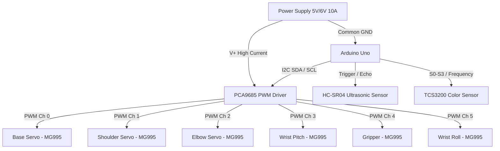

# System Architecture

---

## Architectural Layers
1. **Perception Layer**:
   - Ultrasonic distance sensing detects object arrival in the workspace.
   - TCS3200 color sensor determines object classification.
2. **Decision & Control Layer**:
   - Finite State Machine (FSM) on Arduino orchestrates transitions between scanning, grasping, transport, and release.
3. **Actuation Layer**:
   - PCA9685 converts 12-bit PWM values into pulse durations sent to high-torque servos.
